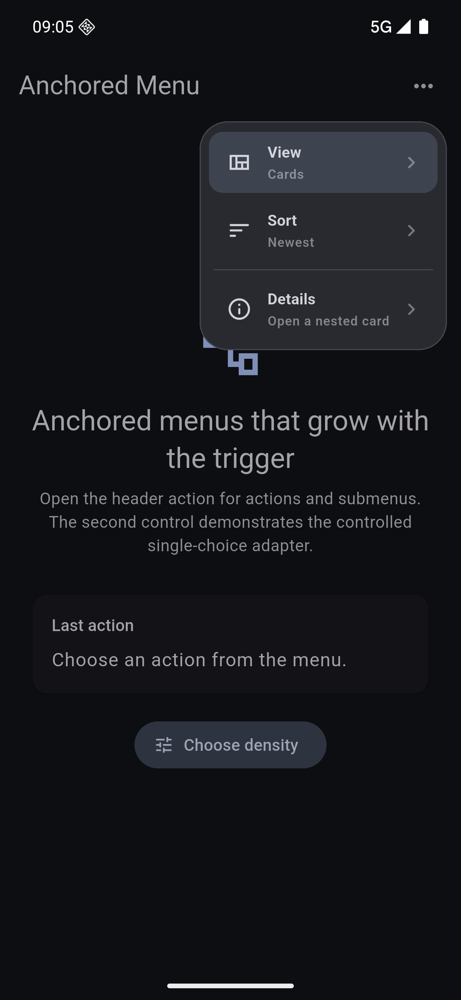
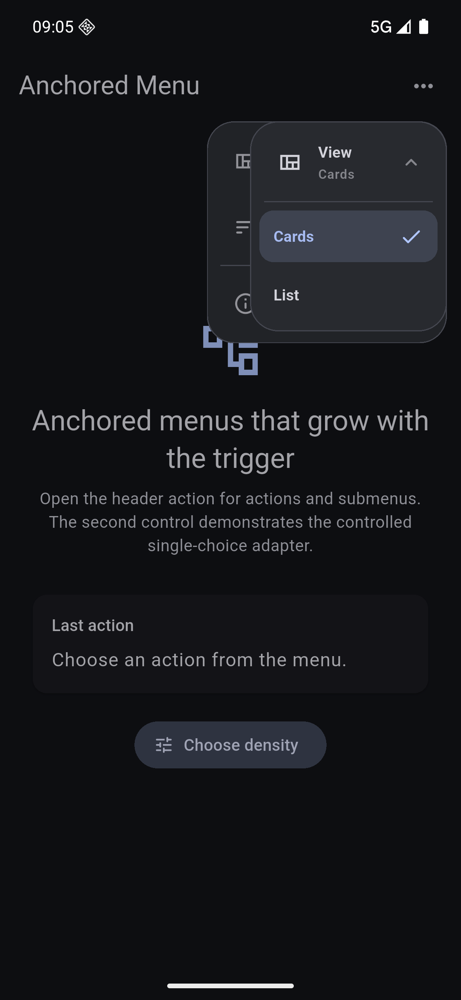

# Anchored Menu

A lightweight anchored popup menu for Flutter with recursive card-style
submenus, controlled selection, and customizable theming.

The menu stays close to the widget that opened it, keeps every ancestor card
visible while navigating a submenu, and works with any trigger widget.





## Features

- Anchored positioning with automatic screen-edge avoidance.
- Recursive submenus with the complete ancestor stack preserved.
- Actions, dividers, icons, subtitles, selected states, and disabled states.
- A controlled single-choice adapter for short static option lists.
- Keyboard navigation with arrow keys, Enter, Space, and Escape.
- Android back handling that returns one submenu level at a time.
- RTL-aware placement, text measurement, and submenu direction.
- Accessibility semantics for menu items and selected values.
- Optional theme extension for surfaces, borders, typography, and radii.
- No platform-specific plugins or third-party runtime dependencies.

## Getting started

Add the package to your `pubspec.yaml`:

```yaml
dependencies:
  anchored_menu: ^0.1.0
```

Import it:

```dart
import 'package:anchored_menu/anchored_menu.dart';
```

## Usage

```dart
AnchoredMenuButton(
  icon: Icons.more_horiz,
  tooltip: 'More actions',
  entries: <AnchoredMenuEntry>[
    AnchoredMenuItem(
      id: 'view',
      icon: Icons.view_quilt_outlined,
      title: 'View',
      subtitle: 'Cards',
      children: <AnchoredMenuEntry>[
        AnchoredMenuItem(
          id: 'cards',
          title: 'Cards',
          selected: true,
          onPressed: () {},
        ),
        AnchoredMenuItem(
          id: 'list',
          title: 'List',
          onPressed: () {},
        ),
      ],
    ),
    const AnchoredMenuDivider(),
    AnchoredMenuItem(
      id: 'settings',
      icon: Icons.settings_outlined,
      title: 'Settings',
      onPressed: () {},
    ),
  ],
)
```

Use `AnchoredMenuAnchor` when the trigger is a custom widget:

```dart
AnchoredMenuAnchor(
  semanticLabel: 'Filter options',
  entries: entries,
  builder: (context, openMenu, menuOpen) => OutlinedButton.icon(
    onPressed: openMenu,
    icon: Icon(menuOpen ? Icons.close : Icons.filter_list),
    label: const Text('Filter'),
  ),
)
```

For a controlled single-choice menu:

```dart
AnchoredMenuChoice<String>(
  values: const <String>['Compact', 'Comfortable'],
  selected: density,
  idOf: (value) => 'density_$value',
  labelOf: (value) => value,
  onSelected: (value) => setState(() => density = value),
  semanticLabel: 'Choose layout density',
  builder: (context, openMenu, menuOpen) => TextButton(
    onPressed: openMenu,
    child: Text(density),
  ),
)
```

## Theming

Install `AnchoredMenuThemeData` as a `ThemeExtension`:

```dart
ThemeData(
  extensions: const <ThemeExtension<dynamic>>[
    AnchoredMenuThemeData(
      panelBorderRadius: BorderRadius.all(Radius.circular(24)),
      itemBorderRadius: BorderRadius.all(Radius.circular(12)),
    ),
  ],
)
```

Unspecified fields resolve from the surrounding Material theme.

## Keyboard and accessibility

- `ArrowDown` / `ArrowUp` move the highlighted action.
- `ArrowRight` opens a submenu in LTR layouts; `ArrowLeft` goes back.
- The horizontal directions are reversed in RTL layouts.
- `Enter`, `NumpadEnter`, and `Space` activate the highlighted action.
- `Escape` closes the current submenu, or the whole menu at the root.

## Example

The runnable example demonstrates nested menus and the controlled-choice
adapter:

```bash
cd example
flutter run
```

## License

BSD 3-Clause. See [LICENSE](LICENSE).
